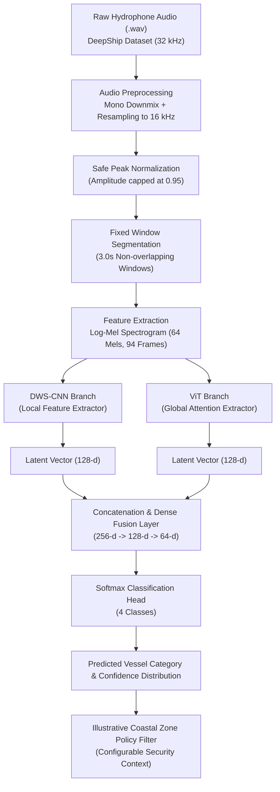
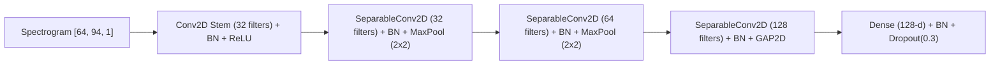

# System Architecture

## 1. Overview

The **Underwater Acoustic Intrusion Detection** system classifies passive underwater sound recordings into four marine vessel categories (**Cargo, Passengership, Tanker, Tug**) using a **Hybrid Depthwise Separable Convolutional Neural Network (DWS-CNN) and Vision Transformer (ViT)** architecture.

Passive acoustic hydrophone signals are first transformed into normalized Log-Mel Spectrogram representations, which are simultaneously fed into two complementary deep learning branches:
* **DWS-CNN Branch:** Extracts local acoustic energy patterns and spatial-frequency textures with high parameter efficiency.
* **ViT Branch:** Extracts global temporal dependencies and cross-frequency harmonic interactions using multi-head self-attention across non-overlapping acoustic patches.

---

## 2. End-to-End System Data Flow

---

## 3. Branch Deep Dives

### 3.1 DWS-CNN Branch

Standard 2D convolutions perform channel cross-correlation and spatial filtering simultaneously, resulting in a large parameter footprint that can rapidly overfit small acoustic datasets. 

The DWS-CNN branch factorizes conventional convolution into two distinct steps:
1. **Depthwise Convolution:** Applies a single spatial convolutional filter ($3 \times 3$) to each input channel independently.
2. **Pointwise Convolution:** Applies a $1 \times 1$ convolution to linearly project and mix channel information.

### 3.2 Vision Transformer (ViT) Branch

The ViT branch models long-term acoustic evolutions (e.g., propeller blade rates, diesel engine firing cadences, rhythmic cavitation cycles) using self-attention.

1. **Zero-Padding:** Pads the time dimension from 94 to 96 frames so the spectrogram ($64 \times 96$) cleanly divides into $8 \times 8$ non-overlapping patches.
2. **Patch & Positional Embedding:** Generates $96$ patch tokens, linearly projects each into $d=64$ latent dimensions, and adds learnable 1D positional embeddings.
3. **Stacked Transformer Encoders (3 Blocks):**
   * Multi-Head Self-Attention ($h=4$ attention heads, $d_k=16$).
   * Pre-Layer Normalization and residual skip connections.
   * Two-layer Feed-Forward Network (MLP) with GELU activations.
4. **Sequence Pooling:** Global Average Pooling across the 96 token positions, followed by LayerNorm and dense projection to $128$-d.

```mermaid
graph LR
    Spec["Spectrogram [64, 94, 1]"] --> Pad["ZeroPad2D -> [64, 96, 1]"]
    Pad --> Patches["Patch Projection (8x8) -> 96 Tokens"]
    Patches --> Pos["+ Learnable Positional Embeddings"]
    Pos --> TB1["Transformer Block 1 (MHA h=4)"]
    TB1 --> TB2["Transformer Block 2 (MHA h=4)"]
    TB2 --> TB3["Transformer Block 3 (MHA h=4)"]
    TB3 --> GAP["Global Avg Pooling 1D"]
    GAP --> Feat["Dense (128-d) + Dropout(0.2)"]
```

---

## 4. Latent Feature Fusion & Classification

The feature representations from the DWS-CNN branch ($\mathbf{h}_{\text{cnn}} \in \mathbb{R}^{128}$) and the ViT branch ($\mathbf{h}_{\text{vit}} \in \mathbb{R}^{128}$) are fused via:

$$\mathbf{h}_{\text{fused}} = \left[ \mathbf{h}_{\text{cnn}} \,\|\, \mathbf{h}_{\text{vit}} \right] \in \mathbb{R}^{256}$$

The fused vector is passed through two progressive non-linear projection stages with Batch Normalization and Dropout:

$$\mathbf{z}_1 = \text{Dropout}\left(\text{BN}\left(\text{ReLU}\left(\mathbf{W}_1 \mathbf{h}_{\text{fused}} + \mathbf{b}_1\right)\right)\right) \in \mathbb{R}^{128}$$
$$\mathbf{z}_2 = \text{Dropout}\left(\text{BN}\left(\text{ReLU}\left(\mathbf{W}_2 \mathbf{z}_1 + \mathbf{b}_2\right)\right)\right) \in \mathbb{R}^{64}$$

Finally, a linear classification layer outputs class posterior probabilities:

$$\hat{\mathbf{y}} = \text{Softmax}\left(\mathbf{W}_{\text{out}} \mathbf{z}_2 + \mathbf{b}_{\text{out}}\right) \in \mathbb{R}^4$$

---

## 5. Distinction Between Vessel Classification & Intrusion Detection

| Capability | Machine Learning Classifier | Operational Intrusion Detection System |
| :--- | :--- | :--- |
| **Output** | Vessel type (Cargo, Passengership, Tanker, Tug) | Threat level (Authorized, Caution, Intruder) |
| **Input Data** | Hydrophone acoustic waveform | Hydrophone audio + AIS Transponder data + Radar + Geo-fencing boundaries |
| **Classification Basis** | Acoustic propeller and engine acoustic frequency spectra | Spatial coordinates, maritime boundary rules, authorization manifests |
| **Academic Note** | No intrinsic "intruder" label exists in DeepShip | Intrusion alert is an operational security rule applied on top of predictions |
