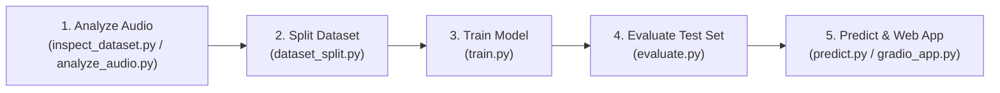

# User & Execution Guide

This guide walks through every phase of running the **Underwater Acoustic Intrusion Detection** system on Windows using PowerShell.

---

## 1. Step-by-Step Workflow Overview



---

## 2. Command Reference

### Phase 1: Inspect Dataset & Extract Audio Metadata

Scans the 63 DeepShip recordings, verifies audio integrity, validates 32 kHz sample rates, and computes duration statistics:

```powershell
python src/analyze_audio.py
```

Outputs created:
* `outputs/audio_metadata.csv`: Verified per-file audio technical metadata.
* `outputs/dataset_inspection_report.json`: Structured duration statistics per class.

---

### Phase 2: Create Zero-Leakage Recording Split

Partitions the dataset at the recording level into 43 Train, 10 Val, and 10 Test recordings, ensuring zero sample overlap:

```powershell
python src/dataset_split.py
```

Outputs created:
* `outputs/dataset_split.json`: Manifest recording lists, leakage audit verification, and loss balancing class weights.

---

### Phase 3: Train the Models

Train the Hybrid DWS-CNN + ViT architecture:

```powershell
python src/train.py --model_type hybrid --epochs 35 --batch_size 16
```

Optional branch training comparisons:
* **Train DWS-CNN only:**
  ```powershell
  python src/train.py --model_type dws_cnn --epochs 35
  ```
* **Train ViT only:**
  ```powershell
  python src/train.py --model_type vit --epochs 35
  ```

Outputs created:
* `models/best_hybrid_model.keras`: Best model checkpoint weights.
* `models/model_metadata.json`: Input shapes and preprocessing parameters.
* `outputs/training_history_hybrid.csv`: Per-epoch loss and accuracy metrics.
* `outputs/training_curves_hybrid.png`: Visualization curves.

---

### Phase 4: Evaluate on Unseen Test Split

Evaluates the saved model against the held-out test recordings:

```powershell
python src/evaluate.py --model_path models/best_hybrid_model.keras
```

Outputs created:
* `outputs/evaluation_report.json`: Test accuracy, precision, recall, and per-class F1-scores.
* `outputs/confusion_matrix_best_hybrid_model.png`: Raw confusion matrix counts.
* `outputs/confusion_matrix_normalized_best_hybrid_model.png`: Normalized recall matrix.

---

### Phase 5: Run Audio Prediction via CLI

Classify an arbitrary underwater WAV recording from PowerShell:

```powershell
python src/predict.py "C:\Users\avlin\Downloads\UNDERWATER PROJECT\DeepShip-main\Cargo\103.wav"
```

Example terminal output:
```text
=================================================================
 UNDERWATER ACOUSTIC VESSEL CLASSIFICATION RESULT
=================================================================
File Analyzed        : 103.wav
Duration             : 199.0s (66 segments)
Predicted Category   : Cargo (Confidence: 89.4%)
-----------------------------------------------------------------
Class Probability Breakdown:
  * Cargo            :  89.4% | ###########################
  * Passengership    :   4.2% | #
  * Tanker           :   5.1% | #
  * Tug              :   1.3% | 
-----------------------------------------------------------------
Illustrative Security Check : [FLAGGED_FOR_INSPECTION]
Note: Under the demo policy 'Marine Protected Area', Cargo vessels
are flagged for zone clearance verification.
=================================================================
```

---

### Phase 6: Launch the Gradio Web Application

Launch the interactive web browser interface:

```powershell
python app/gradio_app.py
```

1. Open your browser at `http://127.0.0.1:7860`.
2. Drag and drop any `.wav` hydrophone audio file (or select one of the provided DeepShip sample examples).
3. Click **"Classify Vessel Type"**.
4. View the predicted class, confidence bar charts, and illustrative security rule evaluation.

---

## 3. Interpreting Predictions

* **Confidence Score:** The mean softmax probability across all segmented 3.0-second windows in the recording. High confidence (>75%) indicates consistent acoustic harmonic patterns matching the vessel class.
* **Duration & Segment Count:** Shows how many stationary windows were averaged to produce the final classification.
* **Illustrative Security Status:** Simulates an operational rule engine applying harbor policies to the acoustic prediction.

---

## 4. Troubleshooting Common Issues

| Issue | Cause | Solution |
| :--- | :--- | :--- |
| `ImportError: No module named 'tensorflow'` | TensorFlow not installed locally | Run `pip install tensorflow` or execute training in Google Colab using `notebooks/training_guide.md`. |
| `ImportError: No module named 'gradio'` | Gradio not installed locally | Run `pip install gradio` to launch web app. |
| `FileNotFoundError: Split manifest not found` | Splitting script not run yet | Run `python src/dataset_split.py` to generate `outputs/dataset_split.json`. |
| `Audio file is too short (< 3.0s)` | Audio duration shorter than segment window | Upload an audio file of at least 3.0 seconds duration. |
